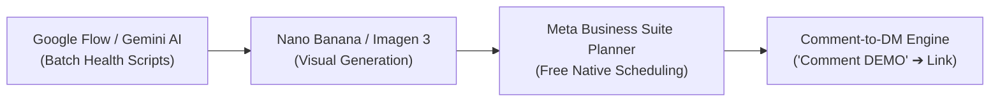

# Aegis Health AI — Social Media Launch Kit & Content Automation Engine
**Official Launch Protocol for Instagram & Facebook**  
*Audited & Verified via Live Chrome Session Inspection*

---

## 1. Verified Live Account Profiles

| Platform | Handle / URL | Current Status | Recommended Action |
|---|---|---|---|
| **Instagram** | [@aegishealthai.co.in](https://www.instagram.com/aegishealthai.co.in/) | ✅ Logged in (0 posts, 0 followers) | Apply bio micro-tune & publish Post #1 |
| **Facebook Page** | [Aegis Health AI (Page 61596273488322)](https://www.facebook.com/profile.php?id=61596273488322) | ✅ Logged in | Set Cover Banner & publish Post #1 |
| **Facebook Profile** | [Admin / Entity (61596060497490)](https://www.facebook.com/profile.php?id=61596060497490) | ✅ Logged in | Cross-share Page Post #1 |

---

## 2. Profile Copy & Setup Reference

### Instagram (`@aegishealthai.co.in`)
* **Display Name**: `Aegis Health AI • Blood Test & Lab Report AI`
* **Category**: `Medical & health`
* **Bio (148/150 chars)**:
  ```text
  🩺 Decode blood tests & lab reports in plain words
  🚀 NVIDIA Inception Member | Govt MSME Registered
  📋 1-page SBAR briefs for doctor visits
  👇 Try free demo
  ```
* **Website Link**:
  `https://aegishealthai.co.in/?utm_source=ig&utm_medium=social&utm_content=link_in_bio`
* **Story Highlights**:
  1. 🚀 **Launch** — NVIDIA Inception milestone & vision.
  2. 🧪 **How It Works** — 4-stage pipeline (PDF ➔ OCR ➔ Longitudinal Trends ➔ SBAR).
  3. 🩺 **Doctors** — SBAR summary clinical brief.
  4. 🔒 **Privacy** — DPDP Act 2023 compliance, zero ads, zero data selling.
  5. 💡 **Daily Tips** — Fast biomarker hacks (HbA1c, Vitamin D, Ferritin).

### Facebook Page (`id=61596273488322`)
* **Page Name**: `Aegis Health AI`
* **Category**: `Medical & Health` / `Software Company`
* **Bio / Tagline**: `Clinical-Grade Medical Intelligence & Longitudinal Health Platform. Official NVIDIA Inception Member.`
* **About / Description**:
  ```text
  Aegis Health AI is an independent, AI-native medical intelligence platform engineered in India. We convert fragmented pathology lab PDFs (Thyrocare, Dr. Lal PathLabs, Metropolis, Tata 1mg) and prescriptions into longitudinal biomarker velocity charts, ICMR-stratified health insights, and physician-ready SBAR clinical briefs. Registered Indian Enterprise (MSME UDYAM-MH-33-0782403). Built with zero-trust privacy under India's DPDP Act 2023.
  ```
* **Cover Banner**: `public/aegis-nvidia-inception-linkedin-banner-2x.png`
* **Action Button**: `Use App` ➔ `https://aegishealthai.co.in/dashboard`
* **Contact Email**: `support@aegishealthai.com`

---

## 3. First Post Packages

### Package A: Official Launch Announcement (Recommended)
* **Visual Asset**: `public/aegis-nvidia-inception-linkedin-banner.png`
* **Caption**:
```text
🚀 We're officially live! Aegis Health AI has joined the NVIDIA Inception program.

Ever received a 6-page blood test report and wondered:
❓ "What do these numbers actually mean for my long-term health?"
❓ "Is my HbA1c or cholesterol improving compared to 2 years ago?"
❓ "How do I explain 5 years of fragmented lab PDFs to my doctor in a 10-minute consultation?"

That’s why we built Aegis Health AI (https://aegishealthai.co.in) 🩺

We’re an AI-native clinical intelligence platform engineered in India to turn complex pathology PDFs into clear, longitudinal health trajectories and physician-ready summaries:

⚡ What Aegis Health AI does:
1️⃣ Multimodal Lab OCR — Dual-tier extraction for reports from Thyrocare, Dr. Lal PathLabs, Metropolis, Redcliffe, Tata 1mg, and handwritten prescriptions.
2️⃣ Longitudinal Biomarker Telemetry — Tracks 50+ biomarkers (HbA1c, Lipids, CBC, LFT, KFT, Vitamin D/B12) over time so you see your velocity, not just a single static number.
3️⃣ Physician SBAR Handover — Automatically synthesizes years of records into a 1-page Situation-Background-Assessment-Recommendation brief your doctor can review in 30 seconds.
4️⃣ Doorstep Phlebotomy Integration — Direct requisition with certified cold-chain pathology networks.

🔒 Zero-Trust Privacy First:
We strictly adhere to India’s DPDP Act 2023. Your health data is client-side zero-knowledge isolated to your user ID, never monetized, and never sold.

🎉 You can evaluate the entire interactive clinical workspace right now with ZERO signup required:
👉 Click the link in our bio or visit: aegishealthai.co.in/dashboard

#AegisHealthAI #NVIDIAInception #HealthTechIndia #AIHealthcare #BloodTest #LabReport #PreventiveHealthcare #MedicalAI #DigitalHealthIndia #DPDPAct #BiomarkerTracking #IndianStartups #MedTech
```

---

### Package B: Viral Health Hack (Nano Banana Creative)
* **Nano Banana Prompt (1:1 Square)**:
```text
A cinematic, ultra-high-definition 3D medical visual for a modern digital health technology platform. A sleek, glowing translucent human silhouette with visible holographic neural pathways and a glowing heart chakra pulse. Floating surrounding glassmorphic data cards displaying glowing clinical biomarker metrics: 'Vitamin D3: 14.2 ng/mL [Low]', 'Ferritin: 18 µg/L [Deficient]', 'TSH: 4.8 mIU/L'. Futuristic yet clean medical aesthetic, deep obsidian dark navy slate background (#090d16), glowing teal-cyan accents (#2dd4bf, #0f766e), subtle soft neon magenta biometric aura. Hyper-realistic render, clean Apple Health and Octane Render style, volumetric studio lighting, zero messy text, 8k resolution, minimalist editorial layout. Aspect Ratio: 1:1 square.
```
* **Caption**:
```text
Always exhausted even after 8 hours of sleep? 😴⚡
It might NOT be laziness or stress.

Over 70% of urban Indians live with chronic daytime fatigue simply because of 3 hidden blood biomarkers that rarely get flagged until they become severe:

1️⃣ Ferritin (Stored Iron): Your hemoglobin can look "normal", but if ferritin is under 30 ng/mL, your cells are oxygen-deprived.
2️⃣ Vitamin D3: Essential for mitochondrial energy and immune regulation. Optimal is 40–60 ng/mL, but Indian city averages hover below 15!
3️⃣ TSH (Thyroid Stimulating Hormone): Even borderline subclinical hypothyroid slows down your metabolic furnace.

💡 Clinical Rule: Never read individual blood numbers in isolation. Biomarkers work in tandem like an orchestra.

Curious what your latest blood report is actually saying?
🔬 Stop letting lab papers collect dust in a drawer.

Try our free, zero-login interactive demo and decode your health trends in 10 seconds:
👉 Visit aegishealthai.co.in/demo (Link in bio 🔗)

💬 Comment "TIRED" below and we’ll DM you the free biomarker checklist!

---
🛡️ Aegis Health AI is an Indian clinical intelligence platform (NVIDIA Inception Member). For health education only; always consult your doctor for medical diagnosis.

#AegisHealthAI #HealthTips #LabReportDecoder #PreventiveHealth #ChronicFatigue #VitaminDDeficiency #ThyroidHealth #IndianHealthcare #HealthTech #BiomarkerTracking #WellnessHacks #NVIDIAInception
```

---

## 4. End-to-End Automation Blueprint



### Content Automation Pipeline
1. **Script Engine**: Use Google Flow with prompt templates to generate 10 posts every Sunday.
2. **Visual Generation**: Generate 1:1 square visuals in Nano Banana using the Aegis dark obsidian & teal color system (`#090d16`, `#0f766e`, `#2dd4bf`).
3. **Scheduler**: Open **Meta Business Suite Planner** (`business.facebook.com`) to queue 2–4 weeks of posts across Facebook & Instagram simultaneously at zero cost.
4. **Growth Funnel**: Use Meta's automated keyword responder (or ManyChat) on the keyword `"DEMO"` to instantly message users the free sandbox URL (`https://aegishealthai.co.in/demo`).
